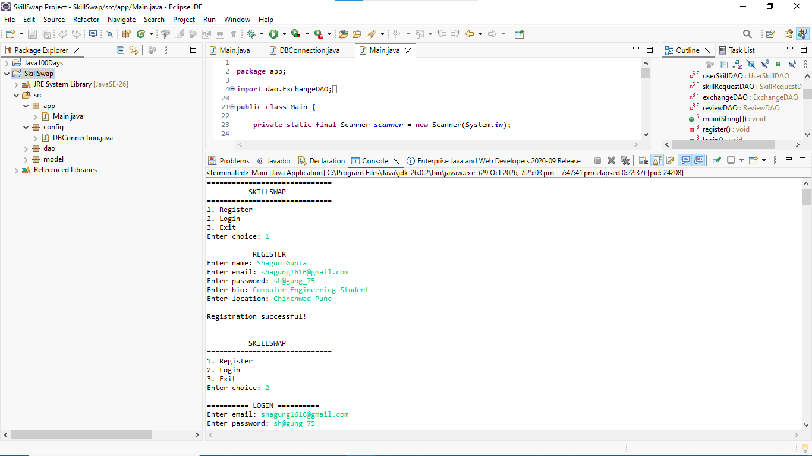
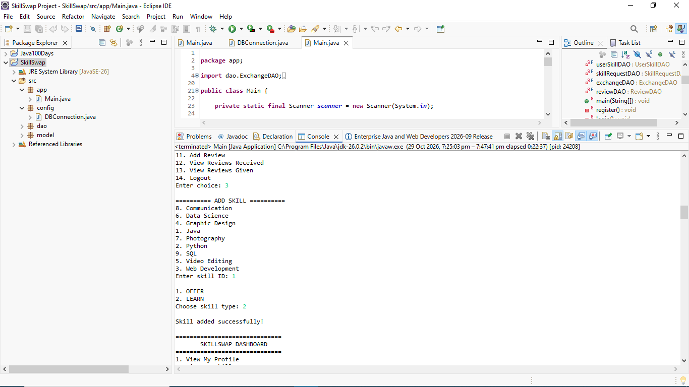
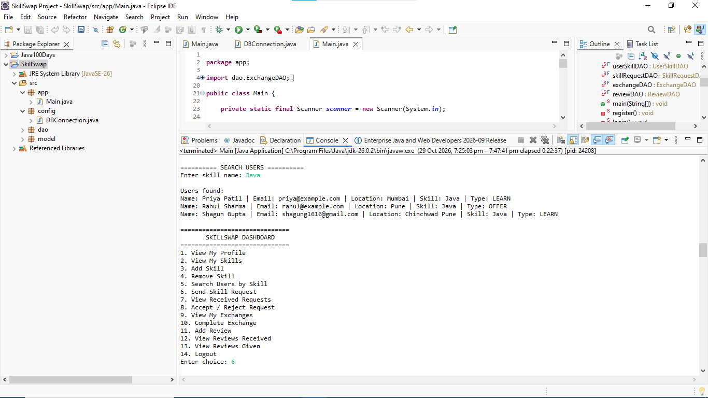

# SkillSwap — Java & MySQL

SkillSwap is a console-based skill exchange application developed using Java and MySQL. It helps users manage their skills, discover skills offered by others, and send skill exchange requests.

## Features

- User registration and login
- User profile management
- Add and remove skills
- Search for users by skill
- Send and manage skill exchange requests
- Accept or reject requests
- Track exchanges and completion
- Submit and view reviews

## Technologies Used

- **Language:** Java
- **Database:** MySQL
- **Database Connectivity:** JDBC
- **Concepts:** Object-Oriented Programming (OOP)
- **IDE:** Eclipse
- **Version Control:** Git and GitHub

## Project Structure

```text
SkillSwap/
├── src/
│   ├── app/
│   ├── config/
│   ├── dao/
│   └── model/
├── database/
│   └── schema.sql
├── lib/
│   └── mysql-connector-j-26.7.0.jar
├── .classpath
├── .project
└── README.md
```

## Prerequisites

- Java JDK
- MySQL Server
- Eclipse IDE or another Java IDE
- MySQL Connector/J JDBC driver

## Database Setup

1. Start your MySQL server.
2. Create the database using the provided `database/schema.sql` file.
3. Configure the database connection in `src/config/DBConnection.java`.
4. Set the `SKILLSWAP_DB_PASSWORD` environment variable to your MySQL password.

**Security:** Never commit database passwords, access tokens, or other credentials to GitHub.

## How to Run

1. Clone or download this repository.
2. Import the project into Eclipse as an existing Java project.
3. Ensure the MySQL Connector/J JAR is available on the project's build path.
4. Create and configure the database.
5. Set the `SKILLSWAP_DB_PASSWORD` environment variable.
6. Run `src/app/Main.java`.

## Learning Outcomes

This project provides practical experience with Java, OOP, JDBC, MySQL database operations, DAO-based code organization, and Git/GitHub.

## Project Status

Educational project developed for learning and demonstrating Java and database integration.

## Author

**Shagun Gupta**

GitHub: [@gshagun16](https://github.com/gshagun16)


## Screenshots

### Main Menu


### User Registration and Login


### Skill Management



